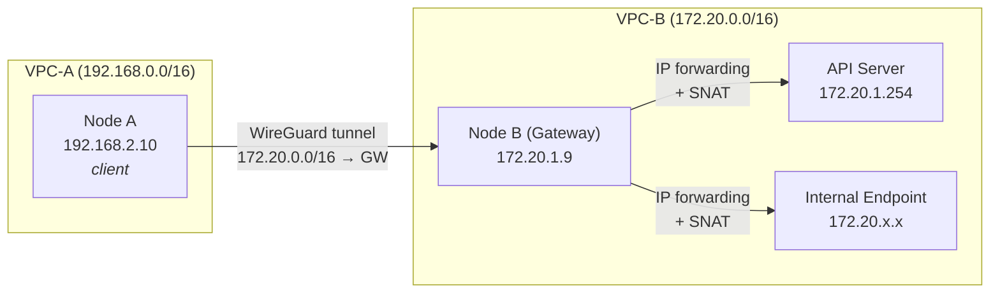
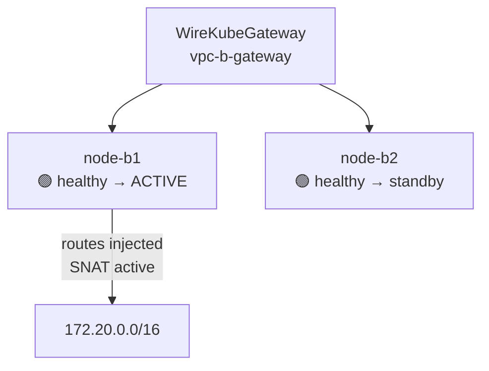

# Virtual Gateway (VGW)

WireKube's Virtual Gateway enables mesh nodes to reach networks behind a
designated gateway node — similar to a VGW in AWS Site-to-Site VPN. This is
essential for multi-VPC topologies where a node in VPC-A needs to access
private link endpoints or internal services in VPC-B.

## Design



A gateway peer acts as a router: it receives WireGuard-encrypted traffic
from client peers, decrypts it, and forwards it into the local network.
Return traffic is SNATed so that the destination sees the gateway's IP as the
source, ensuring correct return path.

To reach a network through its IPsec gateway instead of a node inside it, add
tunnels under `spec.ipsec`; see [Site-to-Site IPsec](ipsec.md).

## CRD: WireKubeGateway

```yaml
apiVersion: wirekube.io/v1alpha1
kind: WireKubeGateway
metadata:
  name: vpc-b-gateway
spec:
  peerRefs:
    - node-b1    # primary gateway
    - node-b2    # backup (HA failover)

  clientRefs:
    - node-a1    # only these peers route through the gateway

  routes:
    - cidr: "172.20.0.0/16"
      description: "VPC-B private link subnet"

  snat:
    enabled: true

  healthCheck:
    enabled: true
    target: "172.20.1.254:443"
    intervalSeconds: 30
    timeoutSeconds: 5
    failureThreshold: 3
```

### Key Fields

| Field | Description |
|-------|-------------|
| `peerRefs` | WireKubePeer names that can serve as gateway, most preferred first. See [High Availability](#high-availability). |
| `clientRefs` | Peers that should route through this gateway. If empty, all mesh peers (except gateway peers and same-CIDR peers) are clients. |
| `routes` | CIDR ranges reachable through the gateway. Injected into the active peer's AllowedIPs. |
| `snat` | Source NAT configuration. When enabled, iptables MASQUERADE rules are added on the gateway node. |
| `healthCheck` | Probe of the target network (TCP connect with a port, ICMP echo without) run by every peer in `peerRefs`. A peer failing `failureThreshold` probes in a row is not eligible. |

## How It Works

### Route Injection

When a WireKubeGateway is created, the agent on the active gateway peer:

1. Adds the gateway CIDRs to its own WireKubePeer's `AllowedIPs`
2. Enables IP forwarding (`net.ipv4.ip_forward = 1`)
3. Adds iptables MASQUERADE rules for each route CIDR

Client peers (those listed in `clientRefs` or all non-gateway, non-same-CIDR peers)
pick up the expanded AllowedIPs during their sync cycle and create:

- WireGuard AllowedIPs entries for the gateway CIDRs on the gateway peer
- Kernel routes in table 22347 pointing the CIDRs through `wire_kube`

### Client Filtering

The agent filters gateway routes based on two criteria:

1. **`clientRefs` membership** — If `clientRefs` is non-empty, only listed peers receive the gateway routes
2. **Same-CIDR exclusion** — Even without `clientRefs`, a peer whose own IP falls within a gateway CIDR is automatically excluded (it already has direct access)

Both WireGuard AllowedIPs and kernel routes are filtered, ensuring zero
unnecessary traffic through the tunnel.

### SNAT (Source NAT)

Without SNAT, packets arriving at the target network carry the client's
mesh IP (e.g. 192.168.2.10) as source. The target has no return route to
that IP, so responses are dropped.

With `snat.enabled: true`, the gateway adds:

```
iptables -t nat -A POSTROUTING -d <cidr> -j MASQUERADE
```

This rewrites the source to the gateway's own IP, which the target network
can route back to.

### Packet Path

```
1. Client (192.168.2.10) sends packet to 172.20.1.254
2. Kernel route: 172.20.0.0/16 → dev wire_kube (table 22347)
3. WireGuard encrypts → tunneled to gateway peer (via relay or direct)
4. Gateway decrypts → IP forwarding → arrives at 172.20.1.254
5. iptables MASQUERADE: src 192.168.2.10 → src 172.20.1.9
6. 172.20.1.254 responds to 172.20.1.9 (gateway)
7. conntrack reverses NAT: dst 172.20.1.9 → dst 192.168.2.10
8. Gateway encrypts → tunneled back to client
9. Client receives response
```

## High Availability

Multiple peers can be listed in `peerRefs`, most preferred first. One
controller, running in whichever agent holds the WireKube leader lease,
decides every gateway's active peer and writes it to `status.activePeer`. All
agents follow that field; none elects on its own.



### Failover Behavior

A peer is **eligible** while all of these hold:

- its WireKubePeer exists and has a public key;
- its agent has reported within the last 90 seconds (agents report every 30);
- with `healthCheck` enabled, its own probe of the target has not failed
  `failureThreshold` times in a row. Every peer in `peerRefs` probes, standbys
  included, so the gateway never fails over to a node that cannot reach the
  target either. Probes run at most once per agent sync.

The controller re-evaluates on every gateway or peer change, and at least
every 30 seconds:

1. While the active peer is eligible, the gateway stays on it.
2. When it is not, the gateway moves to the first eligible peer in `peerRefs`.
3. When a peer earlier in `peerRefs` than the active one has been eligible for
   2 minutes, the gateway returns to it. A flapping node therefore does not
   drag the gateway back and forth.
4. When no peer is eligible, the gateway stays where it is rather than
   withdrawing its routes. The same holds when every agent stops reporting at
   once, which points at status writes failing rather than every node dying:
   the gateway stays on its current peer and does not fail back to one that
   was already down.

The controller also edits every peer's advertised routes itself. It adds the
gateway's `routes` to the active peer's `allowedIPs` and removes them from
every other peer, a dead one included, which could never withdraw its own.
The active peer's agent then enables IP forwarding and SNAT, and terminates
any IPsec tunnels.

`status.peerHealth` records each peer's eligibility, and each node's probe
results appear in its WireKubePeer `status.gatewayProbes`.

### Upgrading From Agent-Elected Gateways

Agents from before the election controller elect gateways themselves: they
take the first `peerRefs` entry whose WireKubePeer exists, and that agent
advertises the routes in its own WireKubePeer. The controller takes a gateway
over only once every live peer in its `peerRefs` reports
`status.gatewayElection` on its WireKubePeer, meaning it runs an agent that
follows the controller. Peers that are gone or silent run no agent and do not
hold this up.

The controller then marks the gateway with the annotation
`wirekube.io/gateway-election: controller`. Until a gateway is marked:

- every agent, old or new, elects it the old way;
- the controller does not touch its status or the routes advertised for it.

During a rolling upgrade both kinds of agent therefore agree on every
gateway.

The controller re-checks this on every pass. If a node comes back still
running an older agent, for example one that was down during the upgrade,
the controller removes the annotation and hands the gateway back to the
agents, since that agent will elect the gateway on its own regardless.

The same failover rules decide which node fronts an external peer (see
[Ingress failover](../reference/crds.md#ingress-failover)).

### Status

```yaml
status:
  activePeer: node-b1
  ready: true
  routesInjected: 1
  peerHealth:
    node-b1: healthy
    node-b2: healthy
  lastHealthCheck: "2026-03-04T13:00:00Z"
  conditions:
    - type: Ready
      status: "True"
      reason: AllPeersHealthy
```

## Use Cases

### Private Link API Server

Some managed Kubernetes services expose the API server only through private
link endpoints inside the VPC. Nodes outside the VPC (e.g. on-premise or
other clouds) cannot reach these endpoints. A gateway node in the VPC bridges
access:

```yaml
spec:
  peerRefs: [node-vpc-worker1]
  clientRefs: [node-onprem1, node-onprem2]
  routes:
    - cidr: "172.20.0.0/16"
      description: "VPC private link"
  snat:
    enabled: true
```

### Multi-Cloud VPC Access

Connect nodes across AWS, GCP, and on-premise through a gateway node in each
VPC that advertises its local CIDR:

```yaml
# Gateway in AWS VPC
spec:
  peerRefs: [node-aws-gw]
  routes:
    - cidr: "10.0.0.0/16"
      description: "AWS VPC"
  snat:
    enabled: true
---
# Gateway in GCP VPC
spec:
  peerRefs: [node-gcp-gw]
  routes:
    - cidr: "10.128.0.0/16"
      description: "GCP VPC"
  snat:
    enabled: true
```

## Limitations

- Gateway introduces a single point of forwarding (mitigated by HA with multiple peerRefs)
- Additional latency for tunneled + forwarded traffic
- MTU overhead: WireGuard (60 bytes) reduces effective MTU; large CIDR routes may need MTU adjustment
- SNAT hides the original client IP from the target network
