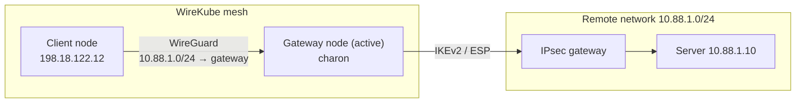

# Site-to-Site IPsec

A [WireKubeGateway](gateway.md) can terminate site-to-site IPsec tunnels
toward the networks in its `routes`, for example a managed VPN gateway or an
on-premises router. The remote side needs only its own IPsec gateway.



## Configuration

Tunnels are listed under `spec.ipsec` of the gateway whose routes they reach:

```yaml
apiVersion: wirekube.io/v1alpha1
kind: WireKubeGateway
metadata:
  name: site-gw
spec:
  peerRefs: [node-a, node-b]       # the first peer with a WireKubePeer terminates the tunnels
  routes:
    - cidr: 10.88.1.0/24           # networks behind the remote IPsec gateway
  ipsec:
    - name: primary
      remoteAddress: 203.0.113.10  # public IP of the remote IPsec gateway
      preSharedKeyRef:
        name: site-psk             # Secret in the agent's namespace, key "psk"
      ike:
        version: 2
        proposals: [aes256-sha256-modp2048]
      esp:
        proposals: [aes256-sha256-modp2048]
```

| Field | Default | Change it when |
|-------|---------|----------------|
| `localID` | the IP address in the active peer's WireKubePeer endpoint | the remote gateway sees the node under another address (another NAT) or expects another identity |
| `remoteID` | `remoteAddress` | the remote presents another identity |
| `localTrafficSelectors` | the mesh CIDR | other ranges (pod CIDRs) must reach the remote |
| `remoteTrafficSelectors` | the gateway `routes` | the tunnel covers only part of them |
| `dataplane` | `Auto` | see [Dataplane modes](#dataplane-modes) |
| `dpd` | 30 s, `restart` | |
| `forceEncapsulation` | off | a firewall passes UDP but not ESP |

Traffic selectors must be IPv4: the plaintext guard covers IPv4 only, so a
tunnel with an IPv6 selector reports `ConfigError`.

Do not enable `snat` on the gateway: the remote side routes the local traffic
selectors back through the tunnel, and SNAT would hide the mesh addresses.

### Remote side

On the remote gateway, the local and remote sides are swapped.
`wirekubectl ipsec remote-config site-gw` prints the values for each tunnel and
each node in `peerRefs`, with the proposals written out as encryption,
integrity and DH group:

| Remote setting | Value |
|----------------|-------|
| Peer address | the gateway node's public IP; one tunnel per node in `peerRefs` |
| Local network | the gateway `routes` |
| Remote network | the mesh CIDR (plus any extra `localTrafficSelectors`) |
| Proposals | the same as `ike.proposals` and `esp.proposals`; the ESP DH group is the PFS group |
| Route table | the mesh CIDR through the tunnel |

The mesh CIDR must not overlap any network the remote reaches, and some
managed VPN services refuse ranges they reserve, such as `100.64.0.0/10`.

On the gateway nodes, allow UDP 500, UDP 4500 and ESP from the remote gateway,
and make sure the `FORWARD` chain accepts the mesh traffic. Docker sets its
default policy to `DROP`. On the remote servers, allow the mesh CIDR.

### Enabling the IKE daemon

```bash
helm upgrade wirekube charts/wirekube --reuse-values \
  --set agent.ipsec.enabled=true \
  --set-string 'agent.ipsec.charon.nodeSelector.wirekube\.io/gateway=true'
```

Use `--set-string` for node selector values; `--set` turns `true` into a
boolean, which a nodeSelector rejects. With `wirekubectl`:

```bash
wirekubectl install --ipsec --charon-node-selector wirekube.io/gateway=true
wirekubectl install --ipsec --charon-image registry.example.com/wirekube-charon@sha256:...
wirekubectl upgrade                    # keeps the stored IPsec settings
wirekubectl upgrade --ipsec=false      # removes charon and the Secret Role
```

This deploys the `wirekube-charon` DaemonSet (`Dockerfile.charon`), sets
`--enable-ipsec` on the agents, and grants the agent `get` on Secrets in its
own namespace. The agent drives charon over the vici socket in
`/run/wirekube-ipsec` on the host.

The charon image defaults to the agent image's repository with a `-charon`
suffix and the same tag. A released `wirekubectl` installs the charon image
released with it, pinned by digest. An agent image given only by digest has
no tag to carry over, so it needs `--charon-image`.

charon listens on the host's UDP 500 and 4500. Label the `peerRefs` nodes of
gateways with tunnels and run charon only there. A gateway elected on a node
without charon reports its tunnels as `Error`.

Restarting or upgrading the agent keeps the established SAs. Restarting charon
closes them, and the tunnels negotiate again.

An agent started without `--enable-ipsec` removes the XFRM interfaces, routes
and rule left by an agent that had it. It keeps the plaintext guard for
gateways that elect it and still define tunnels, so their traffic is dropped,
and those gateways report `ready: false` with each tunnel in `Error`.

### Redundant tunnels

For a remote service that offers two tunnels to the same networks, list both
with identical remote selectors:

```yaml
  ipsec:
    - name: tunnel-1
      remoteAddress: 203.0.113.10
      preSharedKeyRef: {name: site-psk-1}
    - name: tunnel-2
      remoteAddress: 203.0.113.20
      preSharedKeyRef: {name: site-psk-2}
```

Both come up, and the remote networks are routed into one of them, the
carrier: the first in list order that was `Established` at the last sync.
When the carrier loses its CHILD_SA, the routes move to the other tunnel on
the next sync, and they return when the first recovers.
`status.ipsec[].carrier` shows the carrier. This needs the `XFRMInterface`
dataplane; in policy mode only the first tunnel of the group is loaded.
Remote selectors that overlap without being identical are rejected.

## How it works

On the elected peer the agent:

1. Creates an XFRM interface `wkx<if_id>` per tunnel. The ID is derived from
   `<gateway>/<tunnel>` unless `interfaceID` pins it.
2. Routes the remote selectors into that interface from table `0x574C`, at
   `ip rule` priority 198, before the WireGuard table. The route source is the
   node's mesh IP, so traffic the gateway node originates also matches the
   local selectors.
3. Loads the connection `wk-<gateway>/<tunnel>@<hash>` and its pre-shared key
   into charon. The hash covers every setting except the key, so a changed
   setting replaces the connection and takes effect at once; a changed key
   reconnects the tunnel too. The CHILD_SA is bound to the interface with
   `if_id_in`/`if_id_out`. The connection initiates from the mesh side, and a
   loaded connection without an IKE_SA is initiated again on every sync.
4. Adds a drop rule to the `WIREKUBE-IPSEC-GUARD` chain, jumped to from
   `FORWARD` and `OUTPUT`, for each local-to-remote selector pair: a packet
   that IPsec will not process (`-m policy --dir out --pol none`) and that does
   not leave through a `wkx` interface is dropped. Traffic that no SA covers
   is dropped, not sent in plaintext.

Every other node unloads the tunnels and removes their interfaces, routes and
guard rules, which is also how failover works. The first sync after an agent
starts always reconciles, so a restarted agent removes what its previous
process left.

The gateway keeps advertising its routes while a tunnel is down, so client
traffic reaches the gateway node and is dropped by the guard instead of
leaving the clients' own underlay unencrypted.

### Dataplane modes

| Mode | Behaviour |
|------|-----------|
| `Auto` (default) | `XFRMInterface` when the kernel can create XFRM interfaces, `Policy` otherwise. |
| `XFRMInterface` | Route-based, as above. Fails if the kernel cannot create the interface. |
| `Policy` | No interface. The CHILD_SA installs plain policies and the kernel encrypts any forwarded packet matching the selectors. Traffic the gateway node originates is tunneled only if its source falls inside the local selectors. |

On a kernel booted with `ipv6.disable=1`, `xfrm_interface` cannot load, and a
failed load removes every IPsec SA on the node. The agent reads
`/sys/module/ipv6/parameters/disable` and never tries there: `Auto` uses
`Policy`, and an explicit `XFRMInterface` tunnel reports `Error`. Disabling
IPv6 with the `net.ipv6.conf.all.disable_ipv6` sysctl instead keeps XFRM
interfaces working.

## Status

```bash
$ kubectl get wkgw
NAME      ACTIVE   READY   ROUTES   IPSEC             AGE
site-gw   node-a   true    1        1/2 Established   3d

$ wirekubectl ipsec status
GATEWAY  TUNNEL    REMOTE        NODE    PHASE        CARRIER  DATAPLANE      REASON                SINCE  MESSAGE
site-gw  tunnel-1  203.0.113.10  node-a  Established  yes      XFRMInterface  -                     2h     -
site-gw  tunnel-2  203.0.113.20  node-a  Connecting   no       XFRMInterface  AuthenticationFailed  5m     authentication failed: check the pre-shared key and the local and remote IDs
```

The same data is in `status.ipsec`. A gateway with tunnels is `ready` only
while at least one of them is `Established`.

| Phase | Meaning |
|-------|---------|
| `Pending` | None of the gateway's peers is eligible, so no node terminates the tunnel. |
| `Connecting` | The connection is loaded but no CHILD_SA is installed. |
| `Established` | At least one CHILD_SA is installed. |
| `Error` | The active peer could not apply the tunnel; `message` says why. |
| `Unknown` | The active peer stopped reporting for longer than 90s while other peers still report, or its peer object is gone and no other peer can take over, so the controller no longer trusts the state it last wrote. Only for gateways the controller elects; when every peer goes quiet at once the last states stay, since that points at failing status writes. Once marked, the tunnels are not marked again until the holder reports again, so an agent that still writes them with a late heartbeat keeps its states. |

A `Connecting` tunnel shows, for ten minutes, the reason charon logged for
its last failed negotiation: `reason` is one of `ProposalMismatch`,
`DHGroupMismatch`, `AuthenticationFailed`, `TrafficSelectorMismatch` and
`PeerUnreachable`, and `message` says what to change. The charon log line
itself goes to the agent log, once per new line. Other reasons are
`ConfigError` (the tunnel cannot be applied as specified),
`IKEDaemonUnavailable`, `DataplaneError`, `GuardNotInstalled` and, for
`Unknown`, `NotReporting`; treat a reason you do not know as unexplained.

Status is written when something a user can act on changes. `ikeState` and
`installedChildSAs` are recorded with each write but do not cause one, so a
tunnel retrying against a silent peer does not rewrite its status on every
attempt. `wirekube_ipsec_tunnel_child_sas` below carries the live CHILD_SA
count.

`Error` is reported for a tunnel whose plaintext guard could not be installed
(the connection stays loaded), whose local and remote selectors overlap,
whose remote selectors partly overlap another tunnel's on the node, whose
pre-shared key is missing, whose remote identity another tunnel on the node
uses with a different key, or whose interface ID collides. The CRD rejects
malformed addresses, selectors and proposals at admission.

An API error other than NotFound while reading the gateways, peers, mesh or a
pre-shared key skips that sync, so a short API server outage does not tear
down a working tunnel. A teardown charon did not confirm is retried on every sync.

`wirekubectl doctor` fails when a tunnel is not established or a gateway is
active on a node without charon.

### Metrics

| Metric | Labels | Meaning |
|--------|--------|---------|
| `wirekube_ipsec_tunnel_established` | `gateway`, `tunnel` | 1 while a CHILD_SA is installed |
| `wirekube_ipsec_tunnel_child_sas` | `gateway`, `tunnel` | installed CHILD_SAs |
| `wirekube_ipsec_tunnel_carrier` | `gateway`, `tunnel` | 1 for the tunnel the remote networks are routed into |
| `wirekube_ipsec_guard_dropped_packets` | `local`, `remote` | packets the plaintext guard dropped |

Only the node terminating a tunnel exports its series.

## Limits

- Failover follows the gateway election, which moves only when the active
  peer's WireKubePeer disappears or loses its public key. The remote gateway
  needs a tunnel per gateway node.
- A settings change renegotiates the tunnel, with a short interruption.
- Pods reach the remote network only if their addresses are routable through
  the mesh to the gateway and are listed in `localTrafficSelectors`.
- Selectors are static; dynamic routing (BGP) is not supported.
