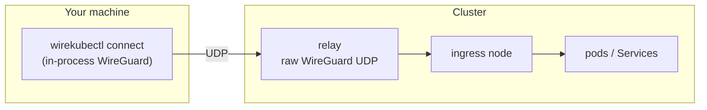

# Connect: Reach Pods and Services from Your Machine

`wirekubectl connect` puts your workstation on the cluster network for as long
as the command runs. Pod IPs, Service ClusterIPs, the mesh overlay and every
`WireKubeGateway` route become reachable from local tools, and names under the
cluster domain (`my-svc.my-ns.svc.cluster.local`, or just `my-svc` in your
kubeconfig namespace) resolve through the cluster DNS.



It is the same path an [external peer](../reference/crds.md#wirekubeexternalpeer) issued with
`wirekubectl external invite` uses, without the manual step of importing a
config into a WireGuard client: the command issues the peer, runs WireGuard
in-process, installs the routes and DNS, follows the peer's status while it
runs, and deletes the peer on exit.

## Requirements

- A WireKube installation whose relay exposes the raw WireGuard UDP endpoint
  (the endpoint `external invite` configs point at). Your machine must be able
  to send UDP to it.
- Permission to create, get and delete `WireKubeExternalPeer` objects, and to
  get the `kube-system/kube-dns` Service for DNS (see [RBAC](#rbac)).
- Linux with root or `CAP_NET_ADMIN`, or macOS with root. Windows support is
  in progress; there the command currently reports that it is unsupported.
- On Linux, DNS needs `systemd-resolved` (`resolvectl`). Without it the tunnel
  still works by IP and the command prints a warning. macOS needs nothing
  extra.

## Usage

```bash
sudo wirekubectl connect
```

```text
issued external peer connect-alice-laptop, waiting for the controller
interface wkconnect0 address 100.64.12.7/32 mtu 1248
ingress worker-3 via relay relay.example.com:30479 (203.0.113.10:30479)
  route 10.96.0.0/12
  route 10.244.0.0/16
  route 100.64.0.0/10
dns *.cluster.local via 10.96.0.10 (search default.svc.cluster.local)
connected; press Ctrl-C to disconnect
handshake with ingress completed
```

Then, from another terminal:

```bash
curl http://my-svc.my-ns:8080/
psql -h postgres.db.svc.cluster.local
```

### Choosing the cluster

`connect` takes kubectl's connection flags, so any cluster you can reach with
kubectl works the same way:

```bash
sudo wirekubectl connect --context staging
sudo wirekubectl connect --kubeconfig ~/.kube/prod.yaml -n payments
sudo wirekubectl connect --context prod --as ops --as-group ops-team
```

`-n` picks the namespace whose Services resolve by short name, falling back to
the context's namespace. Other kubectl flags such as `--cluster`, `--user`,
`--server` and `--token` are accepted as well; see the
[CLI reference](../reference/cli.md#wirekubectl).

Under `sudo`, the invoking user's `~/.kube/config` is used unless
`--kubeconfig` says otherwise. `sudo` drops most of the environment by
default, `KUBECONFIG` included, so pass `--kubeconfig` (or use `sudo -E`) when
you rely on it. The same goes for kubeconfigs whose credentials come from an
exec plugin that reads environment variables or files under your home
directory.

Ctrl-C, SIGTERM, or closing the terminal (SIGHUP) removes the routes, DNS
settings and interface and deletes the peer.

If the process dies without cleaning up (`kill -9`, OOM, power loss), the
interface and routes still go with it: they belong to the process's tunnel
device, which the kernel removes. On Linux the DNS settings live on that
device too. On macOS they are files under `/etc/resolver`, which outlive the
process; each records the pid that wrote it, and the next `connect` removes
any whose process is gone. Until then only names under the cluster domain are
affected. The peer is reclaimed by the controller. The session heartbeats the peer every 30 seconds
(the `wirekube.io/heartbeat` annotation), and the controller deletes a peer
whose heartbeat has not changed for 5 minutes. A later `connect` from the
same user and host also replaces a leftover peer straight away.

A machine that sleeps through those 5 minutes, or loses its network that long,
keeps its session: on resume the session notices the gap, issues a fresh peer
and carries on.

### As a kubectl plugin

Install the binary on your `PATH` as `kubectl-wirekube` and it runs as a
kubectl plugin:

```bash
sudo kubectl wirekube connect --context prod
```

kubectl hands every argument after the plugin name to the plugin, so put the
flags after `wirekube`: `kubectl --context prod wirekube connect` does not work.

### Flags

| Flag | Default | Description |
|------|---------|-------------|
| `--name` | `connect-<user>-<host>` | External peer name. A rerun replaces a leftover peer of the same name that `connect` issued; it refuses to touch any other peer. |
| `--ttl` | `0` | Hard limit on the session: the controller deletes the peer this long after it was issued, which ends the session. A peer reissued after a suspend only gets what is left, and a session resuming past the limit ends. |
| `--allow` | controller defaults | CIDRs to route. Replaces the defaults (mesh, pod, Service and gateway ranges) rather than adding to them. |
| `--ingress-peer` | auto | Pin the session to one `WireKubePeer`. |
| `--mtu` | `1248` | Tunnel MTU. |
| `--interface` | `wkconnect0` on Linux, `utun` on macOS | Tunnel interface name. On Linux use a different name to run two sessions; on macOS it must be `utun` (next free unit) or `utunN`. |
| `--dns` | `true` | Send cluster-domain queries to the cluster DNS. |
| `--dns-server` | `kube-system/kube-dns` ClusterIP | Cluster DNS address, for clusters whose resolver lives elsewhere. |
| `--cluster-domain` | `cluster.local` | Cluster DNS domain. |
| `--search-namespace` | `-n`, else the context namespace | Namespace whose Services resolve by short name. |
| `--wait` | `60s` | How long to wait for the controller to activate the peer. |

## How it behaves

- **Routing.** Only the ranges in the peer's `status.allowedDestinations` go
  through the tunnel. When the controller changes that list (a node joins, a
  gateway is created) the session updates the routes and WireGuard's allowed
  IPs in place. A range that overlaps a network your machine is already on
  produces a warning; the more specific route wins. A range your machine
  already routes exactly, for example through another VPN, is left to that
  route and reported, so disconnecting never removes a route the session did
  not add.
- **Routing loops.** If the relay endpoint itself falls inside a routed range,
  the session refuses to start, because the tunnel's own packets would be
  routed back into the tunnel. Narrow the ranges with `--allow` or expose the
  relay on an address outside them.
- **DNS.** Only names under the cluster domain go to the cluster DNS;
  everything else keeps using your normal resolver.
  - On Linux the cluster domain is set as a routing domain (`~cluster.local`)
    on the tunnel link in `systemd-resolved`. The setting disappears with the
    link.
  - On macOS the session writes `/etc/resolver/cluster.local` (the cluster
    domain to the cluster DNS) and `/etc/resolver/search.wirekube-connect-<utun>`
    (the search domains), and removes them on exit. A resolver file connect did
    not write is never overwritten, and a second session cannot take over the
    domain while the first is still running. `scutil --dns` shows the result.
- **Revocation.** Deleting the peer (`wirekubectl external remove`, TTL expiry)
  while the session is heartbeating ends the session; only a peer reclaimed
  for a missed heartbeat is reissued.

## RBAC

Being able to create a `WireKubeExternalPeer` means being able to reach every
destination the peer is granted, which by default is the whole cluster network.
Grant it deliberately:

```yaml
apiVersion: rbac.authorization.k8s.io/v1
kind: ClusterRole
metadata:
  name: wirekube-connect
rules:
  - apiGroups: ["wirekube.io"]
    resources: ["wirekubeexternalpeers"]
    verbs: ["create", "get", "patch", "delete"]
---
apiVersion: rbac.authorization.k8s.io/v1
kind: Role
metadata:
  name: wirekube-connect-dns
  namespace: kube-system
rules:
  - apiGroups: [""]
    resources: ["services"]
    resourceNames: ["kube-dns"]
    verbs: ["get"]
```

Bind both to the developers who should have cluster network access.
