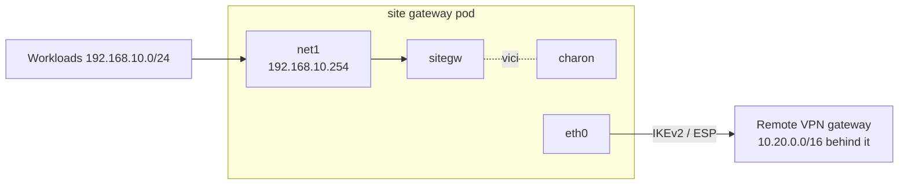

# Standalone Site Gateway

`sitegw` terminates the site-to-site IPsec tunnels of one connection with the
same code as a [gateway peer](../architecture/ipsec.md), but without the
WireKube mesh and without Kubernetes credentials. It runs in its own network
namespace, usually a pod with one leg on a private network and one toward
the remote gateways, and reports its state over HTTP for whatever deployed
it to read.

Use it when the network behind the tunnel is not the mesh: for example one
tenant network of a multi-tenant cluster, where tenants may use the same
address ranges and each gets its own gateway pod.



## Pod layout

| Container | Role | Privileges |
|-----------|------|------------|
| `firewall` (init) | `sitegw firewall`: installs the namespace firewall and turns on IP forwarding | privileged |
| `sitegw` | `sitegw run`: loads the tunnels into charon, keeps the XFRM state and the plaintext guard, serves status | `NET_ADMIN` |
| `charon` | the IKE daemon, from the `-charon` image | `NET_ADMIN` |

`sitegw` and `charon` share the vici socket through an `emptyDir` mounted at
`/run/wirekube-ipsec`. The pod needs no service account token.

The namespace firewall is anchored on the local network's interface (`--tenant-interface`, default
`net1`). Both it and `--uplink-interface` (default `eth0`) must exist, or the
step fails.

- Everything the local network sends to the pod itself is dropped, so the
  status server, metrics and charon are out of its reach. So is everything
  IPsec decrypted for the pod itself: the remote sites cannot reach them
  either. IKE is not carried in ESP, so charon still negotiates.
- Forwarded traffic from the local network is dropped unless an IPsec
  policy or a WireKube XFRM interface takes it, and traffic toward it is
  dropped unless IPsec decrypted it or it came out of an XFRM interface.
- Forwarded traffic that does not touch the local network is dropped, so
  nothing from the uplink side reaches the tunnels, and the gateway routes
  nothing between other networks.
- IPv6 from or to the local network is dropped outright; the tunnels carry
  IPv4 only, and a tunnel with an IPv6 selector reports `ConfigError`. On a
  kernel booted with `ipv6.disable=1` there is no IPv6 to filter.
- IP forwarding is turned on, and `conf/default/rp_filter` set to loose, so
  XFRM interfaces created later accept decrypted traffic without a write to
  `/proc/sys`, which is read-only in the `sitegw` container.

Only traffic that arrives on the local network's interface is routed into
XFRM interfaces, and the plaintext guard covers forwarded traffic only. A
tunnel whose local selectors cover the pod's own uplink address reports
`ConfigError`: its IPsec policies would also take the pod's replies, such
as those to the readiness probe.

`sitegw run` opens its listener only once the firewall is in place.

## Configuration

The tunnels come from a JSON file, `--config` (default
`/etc/sitegw/config.json`; from a ConfigMap, the key `config.json`). Each
entry has the fields of
`spec.ipsec[]` of a WireKubeGateway; `preSharedKeyRef.key` (default `psk`)
names a file in `--key-dir` (default `/etc/sitegw/keys`), and
`preSharedKeyRef.name` is not used. A
trailing newline in a key file is dropped. Unknown fields are refused.

```json
{
  "name": "vpn-a",
  "connectionUID": "8a4f2c1e-0b8d-4c55-9d1e-6a0e7d3f2b10",
  "localTrafficSelectors": ["192.168.10.0/24"],
  "localID": "203.0.113.1",
  "routeSource": "192.168.10.254",
  "tunnels": [
    {
      "name": "tunnel-1",
      "remoteAddress": "198.51.100.10",
      "remoteTrafficSelectors": ["10.20.0.0/16"],
      "preSharedKeyRef": {"name": "vpn-a", "key": "tunnel-1"},
      "forceEncapsulation": true
    }
  ]
}
```

| Field | Meaning |
|-------|---------|
| `name` | Groups the tunnels; their charon connections are `wk-<name>/<tunnel>@...` |
| `connectionUID` | Echoed in the status, so a reader can tell this gateway from an older one |
| `localTrafficSelectors` | Default local selectors of every tunnel: the networks behind the gateway |
| `localID` | Default local IKE identity, usually the public address the remote side expects |
| `routeSource` | Source address of routes into XFRM interfaces |

A tunnel needs `remoteTrafficSelectors`; there is no default. The file is
read on every sync (`--interval`, default 10s). A file that fails to parse
keeps the tunnels of the last good one, and the status says why.

On kernels booted with `ipv6.disable=1` XFRM interfaces are not available
and `Auto` tunnels run in policy mode, as on gateway peers.

## Status

`sitegw run --listen <ip>:<port>` serves three paths on that one address. It
refuses to bind every address.

| Path | Answer |
|------|--------|
| `/v1/status` | The snapshot below, at once; with status 503 while the sync loop has not completed within two intervals |
| `/v1/status?since=<seq>&bootID=<id>&wait=25s` | The snapshot once its `seq` passes `since`, or when `wait` ends (at most 60s); at once if the gateway restarted under another `bootID` |
| `/healthz` | 200 while the sync loop runs, a config has been loaded and charon answers. Tunnel states do not count |
| `/metrics` | `wirekube_sitegw_tunnel_established`, `_tunnel_child_sas`, `_tunnel_carrier`, `_guard_dropped_packets` |

```json
{
  "podUID": "6c1d0f7e-...",
  "connectionUID": "8a4f2c1e-...",
  "bootID": "3f9a1c0d22b84e71",
  "seq": 4,
  "appliedConfigHash": "b1946ac9...",
  "charonReachable": true,
  "tunnels": [
    {"name": "tunnel-1", "phase": "Established", "carrier": true, "dataplane": "Policy", "localTrafficSelectors": ["192.168.10.0/24"], "remoteTrafficSelectors": ["10.20.0.0/16"], "lastTransitionTime": "2026-10-29T03:12:40Z"}
  ],
  "observedAt": "2026-10-29T03:20:11Z"
}
```

`seq` grows within a `bootID` whenever a field worth reporting changes:
phase, reason, message, carrier, dataplane, selectors, identities, the
applied config, the config error or charon's reachability. `ikeState` and
`installedChildSAs` are in the snapshot but do not move `seq`, so a long
poll does not return for every retry against a silent peer.

A reader should keep the newest `(bootID, seq)` it accepted, check
`podUID` and `connectionUID` against what it deployed, and judge freshness
by when it received a snapshot rather than by `observedAt`. A gateway that
stops answering, or whose pod or node is gone, cannot report that itself:
the reader decides when to stop trusting its last snapshot.

## Example

```yaml
apiVersion: v1
kind: Pod
metadata:
  name: sitegw-vpn-a
  namespace: sitegw-system
  annotations:
    k8s.v1.cni.cncf.io/networks: tenant-a/net
spec:
  automountServiceAccountToken: false
  initContainers:
    - name: firewall
      image: inerplat/wirekube:<version>
      command:
        - sitegw
        - firewall
      securityContext:
        privileged: true
  containers:
    - name: sitegw
      image: inerplat/wirekube:<version>
      command:
        - sitegw
        - run
        - --config=/etc/sitegw/config.json
        - --listen=[$(POD_IP)]:8443
      env:
        - name: POD_IP
          valueFrom:
            fieldRef:
              fieldPath: status.podIP
        - name: POD_UID
          valueFrom:
            fieldRef:
              fieldPath: metadata.uid
      securityContext:
        capabilities:
          add:
            - NET_ADMIN
      readinessProbe:
        httpGet:
          path: /healthz
          port: 8443
        periodSeconds: 10
        failureThreshold: 3
      volumeMounts:
        - name: config
          mountPath: /etc/sitegw
          readOnly: true
        - name: keys
          mountPath: /etc/sitegw/keys
          readOnly: true
        - name: vici
          mountPath: /run/wirekube-ipsec
    - name: charon
      image: inerplat/wirekube-charon:<version>
      securityContext:
        capabilities:
          add:
            - NET_ADMIN
      volumeMounts:
        - name: vici
          mountPath: /run/wirekube-ipsec
  volumes:
    - name: config
      configMap:
        name: sitegw-vpn-a
    - name: keys
      secret:
        secretName: sitegw-vpn-a
    - name: vici
      emptyDir:
        medium: Memory
```

The readiness probe reaches the pod on its uplink address, which the
firewall leaves open to the uplink network. Restrict that address with a
network policy to the reader of `/v1/status` and to the metrics scraper;
the policy applies at the pod's interface on the node, which is why the
firewall itself drops what arrives through the tunnels.
